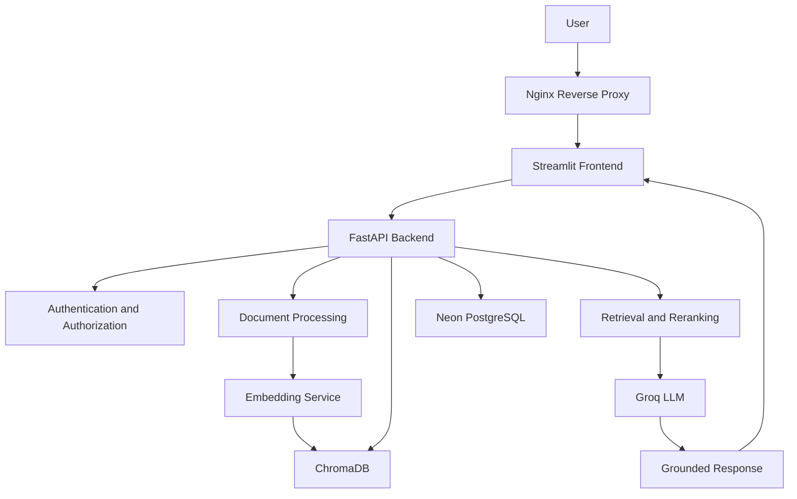

# Enterprise RAG Assistant

A secure, production-oriented Retrieval-Augmented Generation (RAG) application that enables organizations to interact with internal knowledge bases using natural language.

The system combines document-level authorization, hybrid retrieval, reranking, and grounded LLM responses to provide relevant answers while maintaining access control over enterprise documents.

**Live Demo:** [http://13.201.166.115](http://13.201.166.115)  
**Repository:** https://github.com/aadesh7781/Enterprise-RAG-Assistant

> **Note:** The live demo currently uses HTTP. The EC2 public IP is dynamically assigned and may change. Do not submit sensitive information through the demo.

---

## Table of Contents

- [Overview](#overview)
- [Key Features](#key-features)
- [System Architecture](#system-architecture)
- [RAG Pipeline](#rag-pipeline)
- [Retrieval Strategy](#retrieval-strategy)
- [Security and Access Control](#security-and-access-control)
- [Technology Stack](#technology-stack)
- [Project Structure](#project-structure)
- [Getting Started](#getting-started)
- [Environment Configuration](#environment-configuration)
- [Running with Docker](#running-with-docker)
- [AWS Deployment](#aws-deployment)
- [API Health Check](#api-health-check)
- [Engineering Decisions](#engineering-decisions)
- [Future Improvements](#future-improvements)

---

## Overview

Enterprise RAG Assistant is designed to solve a common problem in organizations: employees often need to search through large collections of internal documents to find specific information.

Traditional keyword-based search can struggle with natural-language questions, contextual meaning, and relevant information spread across multiple documents.

This project addresses that problem using Retrieval-Augmented Generation.

Users can upload enterprise documents, ask questions in natural language, and receive context-aware answers generated using an LLM.

The application retrieves relevant document chunks, applies ranking techniques, and provides the retrieved context to the language model before generating a response.

The system also implements document-level authorization to ensure users can only access information they are permitted to view.

## Key Features

### 1. Document Management
- Upload enterprise documents.
- Process and extract document content.
- Split documents into smaller chunks.
- Generate vector embeddings.
- Store document representations in a vector database.
- Track document ingestion and processing.

### 2. Retrieval-Augmented Generation
- Natural-language question answering.
- Semantic retrieval using vector embeddings.
- Hybrid retrieval combining multiple retrieval signals.
- Reciprocal Rank Fusion (RRF).
- Maximal Marginal Relevance (MMR) for relevance and diversity.
- Reranking of retrieved candidates.
- Context-grounded response generation.

### 3. Authentication and Authorization
- JWT-based authentication.
- Role-based access management.
- Document-level access control.
- User-specific document visibility.
- Conversation ownership enforcement.
- Administrative user management.

### 4. Conversation Management
- Persistent conversations.
- Conversation history.
- User-specific conversation ownership.
- Context-aware question answering.

### 5. Administrative Capabilities
- User management.
- Role management.
- Document administration.
- Controlled access to application resources.

### 6. Containerized Deployment
- Separate backend and frontend Docker images.
- Docker Compose orchestration.
- Environment-based configuration.
- Nginx reverse proxy.
- Deployment on AWS EC2.

---

## System Architecture

The application follows a containerized client-server architecture.



### Architecture Components

| Component | Responsibility |
|---|---|
| Streamlit | User interface and interaction |
| FastAPI | Backend API and business logic |
| Neon PostgreSQL | Relational application data |
| ChromaDB | Vector storage and similarity search |
| Jina AI | Embedding generation and reranking |
| Groq | LLM inference |
| Docker | Application containerization |
| Docker Compose | Multi-container orchestration |
| Nginx | Reverse proxy and request routing |
| AWS EC2 | Cloud hosting |

---

## RAG Pipeline

The application uses two major workflows.

### A. Document Ingestion Pipeline

When a user uploads a document, the backend processes it through the following stages:

1. **Document Upload:** The uploaded document is received by the FastAPI backend.
2. **Document Processing:** Text content is extracted from the document.
3. **Chunking:** The extracted content is divided into smaller chunks.
4. **Embedding Generation:** Jina AI generates vector embeddings for the document chunks.
5. **Vector Storage:** The embeddings and associated metadata are stored in ChromaDB.
6. **Metadata Persistence:** Document information and ownership-related data are maintained in PostgreSQL.

### B. Query and Retrieval Pipeline

When a user asks a question:

1. The backend authenticates the user.
2. Authorization rules determine which documents the user can access.
3. The question is converted into a vector embedding.
4. The retrieval system searches for relevant document chunks.
5. Hybrid retrieval combines retrieval signals.
6. Reciprocal Rank Fusion combines ranked results.
7. Maximal Marginal Relevance improves result diversity.
8. Jina reranking evaluates and reorders candidate chunks.
9. Relevant context is passed to the LLM.
10. Groq generates a context-grounded response.
11. The response is returned to the frontend and persisted with the conversation.

---

## Retrieval Strategy

A major focus of this project is improving retrieval quality rather than relying only on basic vector similarity search.

### 1. Semantic Search

Jina Embeddings v3 is used to generate vector representations of user queries and document chunks.

This allows the system to retrieve semantically related content even when the exact keywords differ.

**Embedding configuration:**
- Model: `jina-embeddings-v3`
- Dimensions: `1024`
- Query task: `retrieval.query`
- Document task: `retrieval.passage`

### 2. Hybrid Retrieval

The system combines multiple retrieval signals to improve the relevance of retrieved content.

This helps balance semantic similarity with other retrieval signals.

### 3. Reciprocal Rank Fusion

Reciprocal Rank Fusion combines results from different ranked retrieval lists.

The configured RRF constant is:

`RRF_CONSTANT = 60`

RRF helps produce a unified ranking from multiple retrieval sources.

### 4. Maximal Marginal Relevance

MMR balances relevance and diversity in the retrieved results.

This reduces the likelihood of returning multiple highly similar chunks when other useful information is available.

Configured parameter:

`MMR_LAMBDA = 0.7`

### 5. Reranking

The retrieved candidates are passed through Jina Reranker to improve their ordering based on query-document relevance.

**Reranker model:** `jina-reranker-v3.5`

### Retrieval Configuration

| Parameter | Configuration |
|---|---|
| Embedding model | jina-embeddings-v3 |
| Embedding dimensions | 1024 |
| Vector database | ChromaDB |
| Distance metric | Cosine |
| Reranker | jina-reranker-v3.5 |
| RRF constant | 60 |
| MMR lambda | 0.7 |
| Maximum cosine distance | 0.55 |

---

## Security and Access Control

Security is an important part of this application because enterprise knowledge bases can contain information that should not be accessible to every user.

The application implements multiple security mechanisms.

### Authentication
- JWT-based authentication.
- Token-based access to protected backend endpoints.
- Configurable token expiration.

### Authorization
- Role-based access management.
- Document-level authorization.
- User-specific resource access.
- Conversation ownership validation.

### Data Isolation
- Users should only retrieve documents they are authorized to access.
- Conversation access is restricted to the owning user.
- Backend authorization is enforced rather than relying only on frontend visibility.

### Configuration Security
- Sensitive credentials are stored in environment variables.
- `.env` files are excluded from version control.
- `.env.example` contains placeholder values.
- Application services are configured separately from their secrets.

---

## Technology Stack

| Category | Technologies |
|---|---|
| Frontend | Streamlit |
| Backend | Python, FastAPI |
| Database | Neon PostgreSQL |
| Vector Database | ChromaDB |
| Embeddings | Jina AI Embeddings v3 |
| Reranking | Jina Reranker v3.5 |
| LLM Inference | Groq |
| Authentication | JWT |
| Containerization | Docker |
| Orchestration | Docker Compose |
| Reverse Proxy | Nginx |
| Cloud Infrastructure | AWS EC2 |
| Version Control | Git, GitHub |

---

## Project Structure

```text
Enterprise-RAG-Assistant/
│
├── backend/
│   ├── app/
│   │   ├── api/
│   │   ├── core/
│   │   ├── database/
│   │   ├── models/
│   │   ├── schemas/
│   │   ├── services/
│   │   └── main.py
│   │
│   ├── Dockerfile
│   └── requirements.txt
│
├── frontend/
│   ├── services/
│   ├── Dockerfile
│   └── ...
│
├── docker-compose.yml
├── .dockerignore
├── .env.example
├── .gitignore
├── alembic.ini
└── README.md
```

*The structure above highlights the main application components; individual modules may evolve as the project develops.*

---

## Getting Started

### Prerequisites

Install the following tools:

- Python 3.11 or a compatible project-supported version.
- Docker Desktop or Docker Engine.
- Docker Compose.
- Git.

You will also need credentials for:

- Neon PostgreSQL.
- Groq API.
- Jina AI API.

### 1. Clone the Repository

```bash
git clone https://github.com/aadesh7781/Enterprise-RAG-Assistant.git

cd Enterprise-RAG-Assistant
```

### 2. Configure Environment Variables

Create your local environment file from the example:

**Linux/macOS:**

```bash
cp .env.example .env
```

**Windows PowerShell:**

```powershell
Copy-Item .env.example .env
```

Open `.env` and provide your own credentials.

### 3. Start the Application

Using Docker Compose:

```bash
docker compose up -d --build
```

### 4. Verify Running Containers

```bash
docker compose ps
```

View application logs:

```bash
docker compose logs -f
```

Stop the application:

```bash
docker compose down
```

---

## Environment Configuration

The application uses environment variables to manage configuration and external service credentials.

Example `.env.example`:

```env
# Database
DATABASE_URL=your_neon_postgresql_connection_string

# Authentication
JWT_SECRET_KEY=replace_with_a_secure_random_secret
JWT_ALGORITHM=HS256
ACCESS_TOKEN_EXPIRE_MINUTES=30

# Super Admin
SUPER_ADMIN_EMAIL=admin@example.com
SUPER_ADMIN_NAME=System Administrator
SUPER_ADMIN_PASSWORD=replace_with_a_secure_password

# LLM
GROQ_API_KEY=your_groq_api_key
GROQ_MODEL=openai/gpt-oss-20b

# Embedding and Reranking
JINA_API_KEY=your_jina_api_key
```

**Important:**
- Never commit your actual `.env` file.
- Use strong, unique secrets.
- Do not publish API keys or database credentials.
- Use separate credentials for development and production.

---

## Running with Docker

The application is deployed using Docker Compose with two primary services:

### Backend
- Runs the FastAPI application.
- Handles authentication, document processing, retrieval, and response generation.
- Exposes its internal service on port `8000`.

### Frontend
- Runs the Streamlit application.
- Communicates with the backend through the Docker network.
- Exposes its internal service on port `8501`.

The deployed configuration binds these ports to localhost on the EC2 host. Public traffic is handled through Nginx instead of exposing the application ports directly.

Useful commands:

```bash
# Build and start
docker compose up -d --build

# Check container status
docker compose ps

# Backend logs
docker compose logs -f backend

# Frontend logs
docker compose logs -f frontend

# Restart services
docker compose restart

# Stop services
docker compose down
```

---

## AWS Deployment

The application has been deployed to AWS EC2 using Docker Compose and Nginx.

### Infrastructure

| Resource | Configuration |
|---|---|
| Cloud Provider | AWS |
| Compute Service | EC2 |
| Region | Asia Pacific (Mumbai) |
| Operating System | Ubuntu Server 24.04 LTS |
| Instance Type | t3.small |
| vCPUs | 2 |
| RAM | 2 GiB |
| Storage | 30 GiB gp3 |
| Container Runtime | Docker |
| Reverse Proxy | Nginx |

### Deployment Architecture

```text
                 Internet
                    |
                    |
             AWS EC2 Instance
                    |
                    v
                  Nginx
                 Port 80
                    |
          +---------+---------+
          |                   |
          v                   v
   Streamlit Frontend    FastAPI Backend
      Port 8501            Port 8000
          |                   |
          +---------+---------+
                    |
               Docker Network
                    |
          +---------+---------+
          |                   |
          v                   v
     Neon PostgreSQL       ChromaDB
          |
          |
     External Services
     - Groq API
     - Jina AI API
```

### Deployment Steps

1. Launch an Ubuntu EC2 instance.
2. Configure the security group.
3. Connect to the instance through SSH.
4. Install Docker and Docker Compose.
5. Clone the GitHub repository.
6. Configure production environment variables.
7. Build and start the application using Docker Compose.
8. Install and configure Nginx.
9. Configure Nginx to route incoming HTTP requests to the frontend and backend.
10. Verify the application through the EC2 public IP.

### Network Security

The EC2 security group is configured to allow:

| Port | Protocol | Purpose |
|---|---|---|
| 22 | TCP | SSH administration |
| 80 | TCP | HTTP application access |
| 443 | TCP | HTTPS-ready firewall rule |

The backend and frontend ports are bound to `127.0.0.1` on the EC2 host and are not directly exposed to the public internet.

### Nginx Reverse Proxy

Nginx acts as the entry point for incoming HTTP traffic.

- `/` routes requests to the Streamlit frontend.
- `/api/` routes requests to the FastAPI backend.
- WebSocket upgrade headers support Streamlit communication.
- Request body size is configured to support document uploads.

---

## API Health Check

The backend exposes a health endpoint:

```http
GET /api/v1/health
```

Example successful response:

```json
{
  "status": "healthy",
  "application": "Enterprise RAG Assistant"
}
```

You can verify the deployed backend through:

```bash
curl http://localhost/api/v1/health
```

---

## Engineering Decisions

The project focuses on practical engineering decisions that matter when building enterprise-oriented AI applications.

| Decision | Why it matters |
|---|---|
| FastAPI backend | Provides a structured API layer for application services |
| PostgreSQL | Stores relational application data |
| ChromaDB | Supports vector similarity search |
| Jina embeddings | Converts documents and queries into semantic representations |
| Hybrid retrieval | Combines retrieval signals to improve candidate discovery |
| RRF | Combines multiple ranked result lists |
| MMR | Balances relevance and diversity |
| Reranking | Improves the ordering of retrieved candidates |
| JWT authentication | Protects authenticated application endpoints |
| Document-level authorization | Restricts access to permitted documents |
| Docker Compose | Simplifies multi-service deployment |
| Nginx | Provides a single public entry point |
| AWS EC2 | Hosts the containerized application in the cloud |


---

## Author

**Aadesh Sharma**

Aspiring AI Engineer interested in:

- Large Language Models
- Retrieval-Augmented Generation
- AI Agents
- Backend Engineering
- AI Application Security
- Cloud Deployment

GitHub: https://github.com/aadesh7781

---

## License

This project is intended for educational and portfolio purposes. Add a license file if you intend to distribute or permit reuse of the source code.
